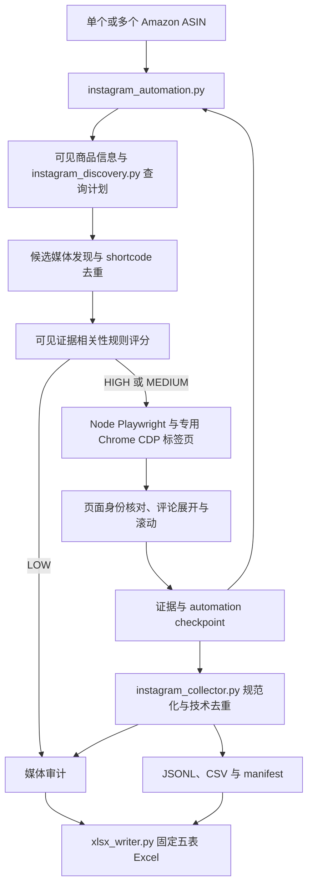

# Instagram VOC 评论采集器

## 一眼看懂

- 这是什么：按商品编号找 Instagram 帖子并采公开评论。
- 什么时候用：想看看图文和短视频底下怎么聊这款商品时。
- 给它什么：商品编号，和一个已登录的 Chrome 窗口。
- 它给你什么：评论明细和五张表 Excel，含媒体与质量记录。

## 项目简介

`instagram-voc-collector` 是由 Amazon ASIN 驱动的 Instagram Post/Reel 公开评论采集工具和 Agent Skill。正式流程从可见 Amazon 商品页面构建商品画像，发现并筛选相关媒体，再通过已登录 Chrome 的 CDP 会话读取实际渲染的评论和回复，输出带审计信息的 JSONL、CSV 与 Excel。

当前包版本为 `1.0.0`。默认运行路径是 Python 编排、Node.js Playwright 和 Chrome CDP；仓库中的扩展保留为显式选择的兼容方式。根目录 [SKILL.md](SKILL.md) 定义 Agent 的运行与交付约定。

## 核心功能

- 接受单 ASIN、多个 ASIN 或 ASIN 文件，生成商品画像和分组查询计划。
- 从渲染页面发现 Post/Reel，按 shortcode 去重，并保留查询与 ASIN 来源关系。
- 根据媒体可见标题、账号、标签和图片替代文本等证据执行规则评分，按 `HIGH`、`MEDIUM`、`LOW` 分级；LOW 媒体只作审计记录。
- 串行展开可见评论和回复、滚动评论容器，核对页面 URL、canonical、`og:url` 与评论链接的媒体身份。
- 保留原始正文与父子关系，按稳定评论 ID 或严格字段组合技术去重；评论相关性标签不用于删除原始行。
- 持续保存 checkpoint，记录未完成媒体及限流冷却状态，并生成固定五表 Excel。

页面显示评论总数仅作审计依据，不能代替实际采集数量。达到目标数量也不代表完整抓取；可见 DOM 的有界采集通常仍应保留 `PARTIAL` 状态。

## 技术栈

| 用途 | 技术 | 仓库约束 |
| --- | --- | --- |
| 流程、发现与导出 | Python 标准库 | `pyproject.toml` 要求 Python ≥ 3.10；`.python-version` 为 3.12 |
| 浏览器控制 | Node.js、playwright-core | 文档要求 Node.js 20+；依赖范围 `^1.63.0`，锁定结果见 `package-lock.json` |
| Chrome 启动 | Windows PowerShell、CDP | 提供 Windows 启动脚本，默认 loopback 端口 9333 |
| 兼容采集 | Chrome 扩展、Python localhost bridge | 通过显式 extension/chrome 传输模式启用 |
| Excel 写入 | 自带 `xlsx_writer.py` | 使用标准库生成 XLSX，无 openpyxl 运行依赖 |
| 测试与持续集成 | unittest、Node test、GitHub Actions | Windows/macOS/Linux；Python 3.10/3.13、Node.js 20 |

`requirements.txt` 当前仅含说明，没有第三方 Python 依赖。跨平台离线测试不代表各平台的真实浏览器采集都已验收；仓库提供的正式启动流程面向 Windows Chrome。

## 快速开始

### 源码与安装

以下是 Windows PowerShell 示例：

```powershell
git clone https://github.com/fubo-ops/instagram-voc-collector.git
cd instagram-voc-collector
python -m venv .venv
.\.venv\Scripts\python.exe -m pip install .
npm ci
.\.venv\Scripts\python.exe scripts/instagram_automation.py --help
```

Python 安装配置和 Node 锁文件均在仓库中。采集器连接系统 Chrome，不需要下载 Playwright 自带 Chromium。离线查看参数也可直接从源码运行 `python scripts/instagram_automation.py --help`。

### 准备专用 Chrome 会话

```powershell
powershell -ExecutionPolicy Bypass -File .\scripts\start_instagram_cdp.ps1
```

启动脚本使用 `127.0.0.1:9333` 和 `outputs/instagram-cdp-profile`；在该 Chrome 窗口人工登录 Instagram。采集时复用此配置，不复制或导出 Cookie、Token。Profile、运行数据与登录资料应保持 Git 忽略。

### 按 ASIN 采集

将示例中的 `ASIN` 替换为目标商品编号：

```powershell
.\.venv\Scripts\python.exe scripts/instagram_automation.py collect --asin ASIN --transport cdp --target-posts 30 --target-comments 1000 --out-dir outputs/run-001
```

多 ASIN 改用 `--asins ASIN1,ASIN2`，或用 `--asin-file asins.csv` 读取本地文件。断点续跑使用同一个 `--out-dir`；状态写入该目录的 `automation_checkpoint.json`。

默认 Instagram 导航等待 20–35 秒，评论/回复操作等待 3–6 秒，每完成 5 个帖子休息 2–5 分钟。遇到限流提示保存 checkpoint 并停止整轮，冷却级别依次为 1、4、12 小时；冷却后的预检和渐进恢复规则见 [采集指南](references/collection-guide.md)。

直接 Post/Reel URL 只用于 `smoke` 调试入口；普通 Chrome 的 `instagram_opencli.py open-comments` 也仅为单帖调试辅助，不替代正式 ASIN 批量入口。

### 输出与交付

运行目录包含评论 JSONL/CSV、查询计划、候选媒体、checkpoint、manifest、媒体审计和 `evidence/<shortcode>/`。Excel 固定写为 `instagram_raw_comments.xlsx`：

| 工作表 | 内容 |
| --- | --- |
| `Raw_Comments` | 可交付媒体的原始评论、回复关系与来源字段 |
| `Media_Audit` | 每个媒体的身份、相关性与覆盖状态 |
| `Query_Plan` | 商品查询计划 |
| `Run_Summary` | 本次运行计数、状态与停止原因 |
| `Quality_Gate` | 质量检查结果 |

脚本将 Excel 写入运行目录。按 Skill 约定集中交付时，由 Agent 或人工复制最终工作簿、按 ASIN 和实际唯一评论数命名，并保留原始证据；仓库没有专门的自动集中复制命令。不要把 JSONL、CSV、checkpoint 或浏览器 Profile 当作公开示例提交。

## 项目结构

以下完整列出 `git ls-files` 中的已跟踪文件，不含依赖、浏览器 Profile 或运行产物：

```text
instagram-voc-collector/
├── .github/
│   └── workflows/
│       └── test.yml
├── .gitignore
├── .python-version
├── LICENSE
├── README.md
├── SKILL.md
├── agents/
│   └── openai.yaml
├── extension/
│   ├── amazon_capture.js
│   ├── bridge_core.js
│   ├── capture.js
│   ├── capture_core.js
│   ├── continuous_capture.js
│   ├── discovery_capture.js
│   ├── manifest.json
│   ├── media_metadata.js
│   ├── media_prepare.js
│   ├── popup.html
│   ├── popup.js
│   ├── service_worker.js
│   └── wake.js
├── package-lock.json
├── package.json
├── pyproject.toml
├── references/
│   ├── collection-guide.md
│   └── raw-record-schema.md
├── requirements.txt
├── scripts/
│   ├── instagram_automation.py
│   ├── instagram_collector.py
│   ├── instagram_discovery.py
│   ├── instagram_opencli.py
│   ├── instagram_playwright_collector.cjs
│   ├── start_instagram_cdp.ps1
│   └── xlsx_writer.py
└── tests/
    ├── test_automation_extension.cjs
    ├── test_capture_core.cjs
    ├── test_instagram_automation.py
    ├── test_instagram_cdp.py
    ├── test_instagram_collector.py
    ├── test_instagram_discovery.py
    ├── test_instagram_opencli.py
    ├── test_instagram_playwright.cjs
    └── test_repository_distribution.py
```

`SKILL.md` 为 Agent 入口，运行说明与字段契约位于 `references/`。扩展中的页面采集资源也被默认 CDP 路径复用。

## 架构图



兼容扩展仍被保存，默认 CDP 流程也复用其中的页面采集脚本；它不会在运行时自动升级或重载扩展。OpenCLI 单帖调试辅助未纳入上面的正式批量流程。

## 当前状态与开发计划

已有 ASIN 输入、查询扩展、候选媒体分级、CDP 采集、回复展开、限流冷却、断点续采和 Excel 导出代码。相关性采用证据词组和规则评分，无法等同人工判断；当前仓库没有独立 LLM 推理服务。

真实运行依赖 Windows Chrome 登录会话和平台 DOM，页面变化、身份不匹配、访问限制或展开入口不完整均可能导致 `PARTIAL` / `BLOCKED`。`PASS` 需要满足覆盖与质量条件，不能以目标数量达成替代。当前代码的最新登录态浏览器验收记录待补充。

仓库提供跨平台离线 CI，但现有 `test_windows_npm_wrapper_uses_node_entrypoint` 依赖测试机用户目录中的 Windows npm/OpenCLI 安装路径；未具备该路径时会失败，测试环境隔离待完善。该问题在未改动的基线代码中同样存在。

仓库没有独立、已确认的后续开发路线图；开发排期、负责人以及其他操作系统的真实采集验收记录待补充。

已有离线验证命令：

```bash
python -B -m unittest discover -s tests -v
npm test
npm run check
```

测试覆盖商品/媒体规则、身份核对、采集格式、限流恢复、扩展页面逻辑和仓库分发结构。测试中的合成页面或模拟传输不代表实时平台可用性。

## 文档

- [Skill 入口](SKILL.md)与 [展示配置](agents/openai.yaml)
- [采集与恢复指南](references/collection-guide.md)
- [原始记录与输出字段](references/raw-record-schema.md)
- [Windows Chrome CDP 启动脚本](scripts/start_instagram_cdp.ps1)
- [Node 依赖与命令](package.json)、[Python 包配置](pyproject.toml)
- [CI 配置](.github/workflows/test.yml)

## 许可证

代码采用 [MIT License](LICENSE)。评论内容与外部平台的授权范围不由本仓库代码许可证授予。
